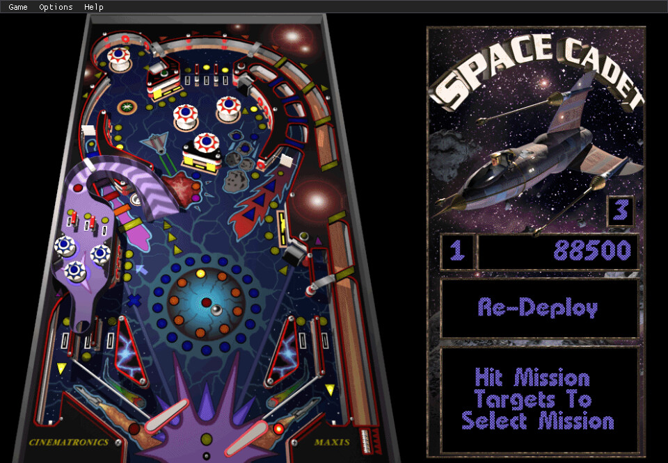
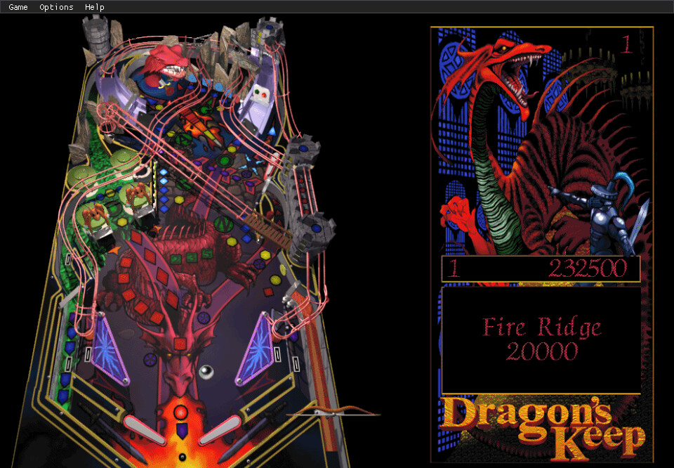
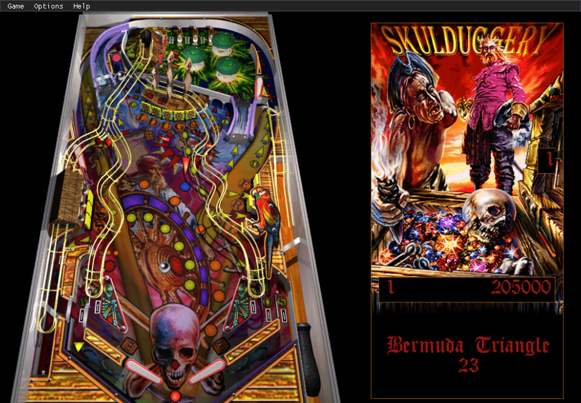
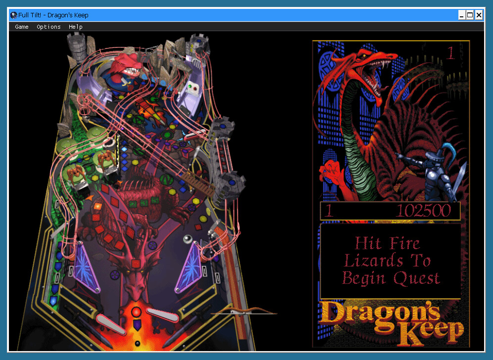

# FullTiltPinball-Native

Native Linux and Windows builds of the three tables of **Full Tilt! Pinball** (Cinematronics /
Maxis, 1995): **Space Cadet**, **Dragon's Keep** and **Skulduggery**. One SDL2 binary plays all
three, on a Linux PC, on a Raspberry Pi 3 arcade cabinet (RetroPie) and on 64-bit Windows.

The project extends [SpaceCadetPinball](https://github.com/k4zmu2a/SpaceCadetPinball) by Andrey
Muzychenko, a reverse-engineered port of the Space Cadet table. Its README is kept as
[UPSTREAM-README.md](UPSTREAM-README.md); the `upstream` git remote points at that repository.

## Status

| Table | Status |
|---|---|
| Space Cadet | Playable natively (the upstream engine and rules, with Full Tilt's data). |
| Dragon's Keep | Playable natively: Full Tilt engine parts and the table's rules reimplemented. |
| Skulduggery | Playable natively: Full Tilt engine parts and the table's rules reimplemented. |

| Platform | Status |
|---|---|
| Linux (x86-64, Raspberry Pi) | Built with CMake and the system's SDL2 packages. |
| Windows (64-bit) | Cross-built from Linux with MinGW-w64 ([Build for Windows](#build-for-windows)). All three tables start, play and quit under Wine; the build has not been run on a Windows installation. |

How the engine was extended: [docs/ARCHITECTURE.md](docs/ARCHITECTURE.md). Current limitations:
[below](#known-limitations).

## Screenshots

The three tables running natively on Linux, each with a ball in play:

<table>
  <tr>
    <td align="center"> Space Cadet</td>
    <td align="center"> Dragon's Keep</td>
    <td align="center"> Skulduggery</td>
  </tr>
</table>

The Windows build (`SpaceCadetPinball.exe`) playing Dragon's Keep under Wine, in Wine's virtual
desktop with its window frame.

## Game data (not included)

You need your own copy of Full Tilt! Pinball. Nothing from it (data, executables, text, music) is in
this repository, and `.gitignore` keeps it out.

Each table lives in its own folder, as on the original CD:

| Table | Folder | Files the port reads |
|---|---|---|
| Space Cadet | `CADET/` | `CADET.DAT`, `SOUND/` |
| Dragon's Keep | `DRAGON/` | `DRAGON.DAT`, `DRAGON.EXE`, `SOUND/` |
| Skulduggery | `PIRATES/` or `PIRATE/` | `PIRATES.DAT`, `PIRATES.EXE`, `SOUND/` |

- `SOUND/` holds the sound effects (`.WAV`) and the music (`.MDS`). When a table folder has both
  `.MDS` and `.MID` music, the `.MDS` files are used.
- Dragon's Keep and Skulduggery read their on-screen text (messages, mission texts, the window
  title) from their original `.EXE` at run time, so the `.EXE` must sit next to its `.DAT`. Without
  it the game stops with "Could not load table text". Space Cadet does not need `CADET.EXE`.
- Keep the file names as they ship (upper case). The port also accepts a `.DAT`/`.EXE` spelled all
  in lower case, and a `sound/` folder whose names are all lower case.

The port looks for the table folders in these places, in order: the working directory, the
directory of the executable, the settings directory (below), `/usr/local/share/SpaceCadetPinball/`
and `/usr/share/SpaceCadetPinball/`. On Windows the list ends after the settings directory. A table may also sit directly in one of those places (the flat
layout: `DRAGON.DAT`, `DRAGON.EXE` and `SOUND/` side by side).

## Build

Needs CMake, a C++11 compiler, and the SDL2 and SDL2_mixer development packages. Music also needs
fluidsynth and a SoundFont (see [Platform/Linux/BUILD.md](Platform/Linux/BUILD.md), including
`SDL_SOUNDFONT`).

    cmake -S . -B build -DCMAKE_BUILD_TYPE=Release
    cmake --build build -j

The binary is written to `bin/SpaceCadetPinball`. The code stays C++11, so it also builds with the
compiler of Raspberry Pi OS Buster (GCC 8.3, SDL 2.0.10).

## Build for Windows

The Windows build is cross-compiled on Linux with MinGW-w64 (64-bit, UCRT) and statically linked
against libgcc and libstdc++, so the output needs no MinGW runtime DLLs.

Needs `bash`, `curl`, `sha256sum`, `tar`, CMake and `x86_64-w64-mingw32-gcc` / `-g++` (with
`-objdump`, used by the import check). `mingwcc.cmake` takes `x86_64-w64-mingw32-g++-posix`
(Debian, Ubuntu) or else `x86_64-w64-mingw32-g++` (Arch, Fedora, MSYS2).

    Platform/Windows/build-mingw.sh            # = deps, then build

- `deps` downloads the pinned MinGW development archives from the official release pages (SDL
  2.32.10 and SDL_mixer 2.8.2, github.com/libsdl-org) into `Libs/downloads/`, checks their SHA-256
  (a mismatch deletes the file and stops), and unpacks the x86-64 part into `Libs/SDL2` and
  `Libs/SDL2_mixer`. A rerun skips what is in place.
- `build` configures `build-win/` with `mingwcc.cmake`, builds Release into `bin-win/` and checks
  that every DLL imported by the executable and the shipped DLLs is in `bin-win/` or is a Windows
  system DLL.

`bin-win/` then holds `SpaceCadetPinball.exe` (GUI subsystem), `SDL2.dll` and `SDL2_mixer.dll`;
nothing else is needed. The executable needs the Universal C Runtime (part of Windows 10 and 11).
`Libs/`, `build-win/` and `bin-win/` are git-ignored. The command-line equivalent of `build`:

    cmake -S . -B build-win -DCMAKE_TOOLCHAIN_FILE=$PWD/mingwcc.cmake -DCMAKE_BUILD_TYPE=Release \
          -DFT_OUTPUT_DIR=$PWD/bin-win && cmake --build build-win -j

To play, put the three files and the table folders (`CADET/`, `DRAGON/`, `PIRATE/`, see
[Game data](#game-data-not-included)) in one folder, or start the executable from the folder that
holds the table folders, and run `SpaceCadetPinball.exe -table=dragon` (options as below). The
upstream MSVC route (`BuildForWindows.ps1`) is not used for the port's sources.

## Run

    bin/SpaceCadetPinball -table=dragon

| Option | Effect |
|---|---|
| `-table=cadet`, `-table=dragon`, `-table=pirates` | Start that table (`3dpb` and `demo` select the 3D Pinball and Full Tilt demo data). An unknown id stops with a list of the valid ones. Applies to this launch only. |
| `-fullscreen` | Start in full screen. |
| `-sw` | Use SDL's software renderer. |
| `-noaudio` | Do not open the audio device. |
| `-quick` | Do not load sounds and music. |
| `-demo` | Start in demo (attract) mode. |
| `-reset` | Reset every option to its default. |

Without `-table=`, the port starts the table last chosen in **Options > Table** (the menu lists the
tables it can find and restarts on a choice). With no choice stored it uses upstream's order
(`CADET.DAT`, `PINBALL.DAT`, `DEMO.DAT`, flat layout only), then Dragon's Keep, then Skulduggery.

Controls and menus are upstream's (F9 shows or hides the menu bar). Dragon's Keep and Skulduggery
wait 2 s after the window opens before the first game starts, as the originals do.

## Settings and high scores

Settings live in `imgui_pb.ini` in SDL's per-user data directory: on Linux
`$XDG_DATA_HOME/SpaceCadetPinball/` (normally `~/.local/share/SpaceCadetPinball/`), on Windows
`%APPDATA%\SpaceCadetPinball\`. The file has the same keys on both.

- All options (controls, sound, music, graphics) are shared by the three tables.
- High scores are kept per table: Space Cadet uses upstream's keys (`0.Name`, `0.Score`, ...,
  `Verification`), so existing Space Cadet scores carry over; Dragon's Keep uses keys starting with
  `DragonsKeep.`, Skulduggery keys starting with `Skulduggery.`.
- The chosen table is stored as `Table`.

## Known limitations

- **Music is off by default.** The `Music` option defaults to off (as upstream) and is one setting
  for all three tables (**Options > Audio**, the F6 key, or `Music` in `imgui_pb.ini`).
- **Memory use with music.** SDL_mixer creates a separate fluidsynth synthesizer, with its own copy
  of the SoundFont, for every loaded music track. Dragon's Keep and Skulduggery load six tracks,
  Space Cadet three. Measured on the Raspberry Pi 3 with music on: about 440 MB resident for the two
  Full Tilt tables against about 304 MB for Space Cadet.
- **fluidsynth warnings when music restarts.** When a track restarts (pause and resume, a new game,
  a track change), fluidsynth sometimes runs out of voices and prints thousands of
  `Ringbuffer full` / `Failed to allocate a synthesis process` warnings to stderr; notes are dropped
  while it lasts. The upstream build on the same Pi does not show this. The cause is not found yet.
- **Windows music backend.** SDL_mixer's Windows build has no fluidsynth, so `SDL_SOUNDFONT` does
  not apply. MIDI goes to Timidity (which logs "Couldn't open timidity.cfg" when it has no
  configuration) and then to Windows' native MIDI synthesizer. Under Wine all six Dragon's Keep
  tracks load; whether the music sounds right was not checked, because the tests run without
  audible output.
- **Windows log output.** The Windows executable is a GUI program, so its log is not visible
  unless the output is redirected (under Wine it reaches the terminal).
- **Windows is tested under Wine only**, with SDL's `direct3d` renderer (`-sw` also works).
- **The `.EXE` is required** for Dragon's Keep and Skulduggery (their text is not in the repository;
  see [Game data](#game-data-not-included)). Two longer texts (the quotes and the credits ticker)
  are read only from the exact `DRAGON.EXE` / `PIRATES.EXE` builds of the retail release, checked
  by size and SHA-256.
- **Space Cadet follows upstream, not CADET.EXE.** Where Full Tilt's own Space Cadet behaves
  differently from upstream's (for example the tilt timeout: 15 s in CADET.EXE, 30 s upstream),
  Space Cadet keeps upstream's behaviour. See [docs/ARCHITECTURE.md](docs/ARCHITECTURE.md).

## Testing

The port is tested against the original executables running under Wine, with a native test hook
build and a side-by-side screenshot and memory-probe harness. The Windows build is run under Wine
as well. See [docs/TESTING.md](docs/TESTING.md).
The reverse-engineering tools and findings are in [docs/REVERSE_ENGINEERING.md](docs/REVERSE_ENGINEERING.md).

## Repository layout

| Path | Contents |
|---|---|
| `SpaceCadetPinball/` | The engine (upstream, extended) and Space Cadet's rules (`control.cpp`) |
| `SpaceCadetPinball/rules/` | The rules of Dragon's Keep (`dragon_*`) and Skulduggery (`pirates_*`), and their shared code (`ft_common.*`) |
| `docs/` | Architecture, testing and reverse-engineering documentation |
| `re/` | Reverse-engineering tools (Python, Ghidra script); `re/work/` is a local, git-ignored workspace |
| `re/test/` | Test harness: Wine vs native runs, the native test hook runner and its scripts |
| `CMakeLists.txt`, `CMakeModules/`, `Platform/`, `mingwcc.cmake` | Build files (upstream's, plus the port's sources and options); `Platform/Windows/build-mingw.sh` is the Windows cross-build |
| `UPSTREAM-README.md`, `CONTRIBUTING.md`, `Doc/`, `Screenshots/` | Upstream's documentation |
| `bin/`, `build/`, `build-hook/`, `bin-win/`, `build-win/`, `Libs/` | Build output and downloaded SDL libraries (git-ignored) |

## Credits and licence

- Original game: Full Tilt! Pinball by Cinematronics, published by Maxis (1995).
- SpaceCadetPinball: Andrey Muzychenko and contributors, MIT licence ([LICENSE](LICENSE)).
- The Dragon's Keep and Skulduggery engine parts and rules in this repository are a
  reimplementation, written against the behaviour of the original executables.
- The repository's licence file is upstream's MIT licence.
